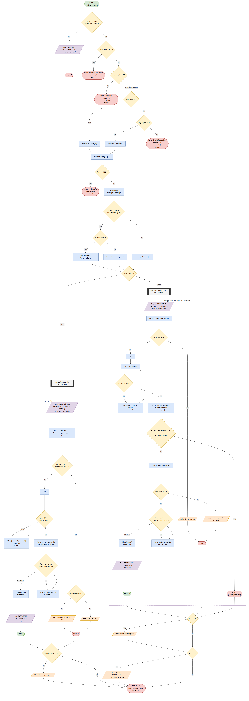

# XOR File Encryptor / Decryptor (C)

A command-line tool written in C that encrypts and decrypts text files using an **XOR cipher**. The **first character of the password** is the XOR key. The full password is also stored (encrypted) in the file header, so a wrong password is detected before decryption starts.

Built as a mini project to practice **modular C** (separate `src/` and `inc/`) and a **Makefile based build**.

> **Note:** This is a learning project. A single-character XOR key is easy to break and must not be used to protect real data.

---

## Features

- Encrypt a text file (`.txt`) into an encrypted file (`.enc`)
- Decrypt an `.enc` file back to the original text
- Password verification: decryption stops with an error if the password is wrong
- Command-line flags (`-e`, `-d`, `--help`) with argument checking
- Default output file names when none are given

---

## How it works

XOR is reversible: applying it twice with the same key returns the original value.

```
plain  XOR key = cipher
cipher XOR key = plain
```

**Encryption**

1. The user enters a password (max 9 characters, no spaces).
2. The key is `password[0]`.
3. Each password character is XORed with the key and written as the first line of the output file (the header).
4. Every byte of the input file is XORed with the key and written after the header.

**Decryption**

1. The user enters the password.
2. The header line is read and XORed with `password[0]`.
3. If the result does not match the entered password, the program stops with `WRONG PASSWORD FOR DECRYPTION`.
4. Otherwise, the rest of the file is XORed with the key and written to the output file.

**Encrypted file layout**

```
[ password XOR key ] \n
[ file data XOR key ]
```

---

## Flowchart

<details>
<summary>Click to expand the flowchart</summary>

[](flowchart.png)

</details>
---

## Project structure

```
C_mini_project/
├── src/
│   ├── main.c        # entry point, argument parsing, mode selection
│   └── encdec.c      # encrypt() and decrypt() logic
├── inc/
│   └── encdec.h      # declarations, crypto struct, mode enum
├── flowchart.png
├── Makefile
└── README.md
```

---

## Requirements

- GCC (or any C compiler)
- GNU Make

---

## Build

```bash
make          # build the project
make clean    # remove build output
```

---

## Usage

```
<executable_name> <flag> <input_file> [output_file]
```

| Flag     | Mode    | Input file | Output file (default) |
|----------|---------|------------|-----------------------|
| `-e`     | Encrypt | `.txt`     | `.enc` (`encrypted.enc`) |
| `-d`     | Decrypt | `.enc`     | `.txt` (`output.txt`)    |
| `--help` | Show usage information | | |

Replace `<executable_name>` with the name your Makefile produces.

### Examples

Encrypt:

```bash
./<executable_name> -e message.txt secret.enc
ENTER THE PASSWORD TO ENCRYPT
        1. LESS THAN 10 CHARACTERS:
        2. NO SPACES ALLOWED
PASSWORD: hello
ENCRYPTED SUCCESFULLY at secret.enc
```

Decrypt:

```bash
./<executable_name> -d secret.enc recovered.txt
ENTER THE PASSWORD TO VERIFY: hello
DECRYPTED SUCCESFULLY at recovered.txt
```

Using the default output names:

```bash
./<executable_name> -e message.txt     # writes encrypted.enc
./<executable_name> -d encrypted.enc   # writes output.txt
```

---

## Error handling

| Situation                  | Result                                   |
|----------------------------|------------------------------------------|
| Too few or too many arguments | Error message and a hint to run `--help` |
| Invalid flag               | `invalid flag options : -e and -d`       |
| Input file missing         | `the input file does not exist`          |
| Output file cannot be created | `failing to create output file`       |
| Wrong password on decrypt  | `WRONG PASSWORD FOR DECRYPTION`          |

---

## Limitations

- Only the first character of the password acts as the key, so `hello` and `hat` decrypt the same data (the header check still requires the full password).
- A single-byte key gives only 256 possible keys, so it is easily brute-forced.
- The header reveals the password length.
- Passwords are limited to 9 characters with no spaces.
- Intended for text files.

## Possible improvements

- Use the whole password as a repeating key
- Hash the password for verification instead of storing it XOR-encoded
- Support binary files
- Hide password input while typing

---

## What I learned

- Splitting a C program into modules with headers and source files
- Writing a Makefile with separate `src/`, `inc/`, and `build/` directories
- Bitwise XOR and its reversible property
- File handling in C (`fopen`, `fscanf`, `fprintf`) and command-line arguments (`argc`, `argv`)
- Return codes for error handling

---

## License

MIT
